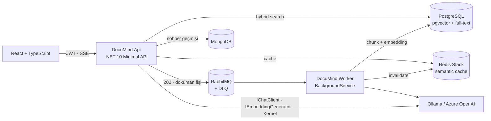

# DocuMind

[](https://github.com/NejatSENER/documind/actions/workflows/ci.yml)

Şirket dokümanlarıyla sohbet eden bir RAG asistanı. Dokümanlar parçalara bölünüp vektöre çevriliyor, sorular hybrid search ile aranıyor, cevaplar yalnızca bulunan kaynaklara dayanarak, kaynak etiketiyle ve SSE üzerinden akış halinde üretiliyor. İsteğe bağlı olarak iki agent'lı (araştırmacı + denetçi) bir Semantic Kernel akışı da var.

## Mimari



| Proje | Görevi |
|---|---|
| `DocuMind.Core` | Chunking, embedding, pgvector deposu, hybrid search, prompt, query rewriting, reranker, semantic cache, sohbet geçmişi, Semantic Kernel agent'ları, DI kayıtları |
| `DocuMind.Api` | `/auth/login`, `/documents` (admin), `/chat/stream` ve `/agent/stream` (SSE), React arayüzünü sunar |
| `DocuMind.Worker` | RabbitMQ kuyruğunu dinler, dokümanları işler, cache'i temizler |
| `DocuMind.Tests` | xUnit testleri (17), LLM için sahte `IChatClient` |
| `web/` | React + TypeScript (Vite) arayüz, derlenince `Api/wwwroot`'a gider |
| `eval/` | 12 soruluk golden set ve retrieval karşılaştırması |

## Çalıştırma

```bash
docker compose up -d            # PostgreSQL+pgvector, MongoDB, Redis Stack, RabbitMQ
ollama serve                    # ayrı bir terminalde
ollama pull qwen2.5:7b && ollama pull nomic-embed-text
dotnet run --project src/DocuMind.Worker
dotnet run --project src/DocuMind.Api --urls http://localhost:5258
```

Arayüz: http://localhost:5258 · RabbitMQ paneli: http://localhost:15672. Geliştirme kullanıcıları ve JWT anahtarı `src/DocuMind.Api/appsettings.Development.json` içinde. Başka bir ortamda `Jwt__Key` ortam değişkeni (en az 32 byte) verilmezse API açılmaz. Arayüzü değiştirince `cd web && npm run build`.

Testler ve değerlendirme:

```bash
dotnet test DocuMind.slnx
cd eval && dotnet run run-eval.cs
```

## Tasarım kararları ve ölçümler

| Konu | Karar | Neden |
|---|---|---|
| Chunking | Recursive (paragraf → cümle), 1000 karakter, cümle sınırından overlap | TDD ile geliştirildi. Overlap'in cümle ortasından başlaması gerçek dokümanda fark edilip testle düzeltildi |
| Retrieval | Hybrid: pgvector kosinüs + PostgreSQL Türkçe full-text, RRF ile birleştirme | Golden set'te hit@1: yalnızca vektör **9/12**, hybrid **11/12** |
| Reranking | LLM reranker var ama kapalı (`Rag:Rerank`) | Aynı sette **10/12**, soru başına +3 sn. 7B model iyi bir hakem değil |
| Grounding | Yalnızca kaynaklardan cevap, `[K1]` etiketleri, sabit "bulunamadı" cümlesi | Alakasız bir soru (0,687) cevaplı bir sorudan (0,679) yüksek benzerlik aldı, eşik tek başına ayıramıyor |
| Semantic cache | Redis HNSW, eşik **0,95**, TTL 1 saat, "bulunamadı" ve yarım cevaplar cache'lenmez, yeni dokümanda invalidation | "Yıllık izin kaç gün" ile "babalık izni kaç gün" 0,896 benzer, düşük eşik yanlış cevap döndürür |
| Sohbet geçmişi | MongoDB + son 6 mesajla query rewriting (few-shot) | Context window'u şişirmeden takip sorularını çözer |
| Ingestion | RabbitMQ, manuel ack, prefetch 1, DLQ, upsert ile idempotent | API 202 döner, Worker kapalıyken mesaj kaybolmaz |
| Agent'lar | Semantic Kernel `ChatCompletionAgent`: araştırmacı (`[KernelFunction]` arama aracı) + denetçi (JSON karar) | 7B model function calling'de güvenilmezdi, ilk arama deterministik, ek arama agent'ta |
| Sağlayıcı | `Llm:Provider` = `Ollama` / `AzureOpenAI`, `IChatClient` + `IEmbeddingGenerator` | Kod değişmeden geçiş. Azure yolu derleniyor, test edilmedi |
| Güvenlik | JWT (HMAC-SHA256, 30 dk), `admin` politikası, token bellekte | Kaynak metinler veri olarak işaretli (prompt injection) |
| CI | GitHub Actions: Release build `-warnaserror`, test + coverage, SonarCloud quality gate job'ı | |

## Bilinen sınırlar

- Embedding modeli (`nomic-embed-text`) İngilizce ağırlıklı, Türkçe skorlar birbirine yakın, diller arası arama çalışmıyor. Çok dilli bir model (ör. `bge-m3`) denenmeli.
- Query rewriting bazen anlamı kaydırıyor ("5 yılını dolduran" → "5 yıldan sonra işe giren"). Hata sonraki adımlara yayılıyor, sistem "bulunamadı" diyerek güvenli başarısız oluyor.
- Mesajda dokümanın tamamı taşınıyor. Büyük dosyalar için Blob Storage + claim-check gerekir.
- Demo kullanıcılar config'de duruyor. Gerçek ortamda Key Vault ve bir kimlik sağlayıcı (Entra ID) kullanılmalı.
